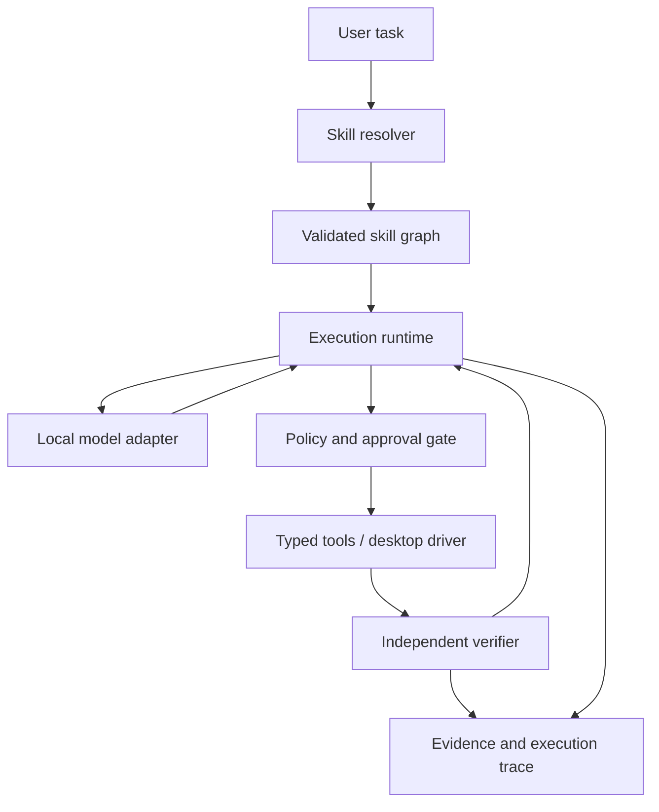

# SkillLift

> Small models. Real capabilities.

**SkillLift is a proposed open-source, local-first skill runtime and evaluation framework for helping small language models perform real computer tasks through structured execution, bounded autonomy, independent verification, and recovery.**

**Status: research blueprint / pre-implementation.** No runtime, installable package, benchmark results, or security guarantees are available yet.

## Why SkillLift?

Local models are inexpensive to run and keep inference on the user's hardware, but long-horizon instructions, tool selection, state tracking and error recovery can be unreliable. Instead of asking a small model to reason about every operation, SkillLift aims to move predictable work into a deterministic runtime and reserve model inference for decisions that actually need it.

The research question is not whether SkillLift can replace a frontier model. It is whether a carefully designed execution environment can improve task completion at a fixed model and hardware budget, and under what conditions that improvement generalizes.

## Design principles

- Local-first: no cloud model API or external account required for the initial supported offline workflows.
- Model-agnostic: local adapters, not a new foundation model.
- Structured skills: versioned plans, typed inputs, explicit permissions and verifiable postconditions.
- Bounded autonomy: model outputs are proposals, never authority to expand permissions.
- Evidence over claims: measure task outcomes, cost and failure modes against fair baselines.
- Composable infrastructure: reuse existing computer-use drivers rather than reimplement everything.

## Planned architecture

First reference platform: Apple Silicon macOS, 24 GB unified memory; Python core, local Ollama adapter, isolated filesystem tasks, then a bounded macOS accessibility adapter. MLX and additional platforms are candidates, not initial requirements.

## Project documents

| Document | Purpose |
| --- | --- |
| [BLUEPRINT.md](BLUEPRINT.md) | Product scope, architecture, technical decisions and non-goals |
| [ROADMAP.md](ROADMAP.md) | Solo-development phases, deliverables and acceptance gates |
| [Research protocol](docs/RESEARCH_PROTOCOL.md) | Controlled experiments, metrics and evidence standards |
| [Safety model](docs/SAFETY.md) | Threat model, approval boundaries and fail-closed behavior |
| [Phase 0](docs/PHASE_0.md) | Concrete first experiments and implementation backlog |
| [AGENTS.md](AGENTS.md) | Instructions for human and AI contributors |
| [中文專案摘要](docs/README.zh-TW.md) | Traditional Chinese project overview |

## Related work

SkillLift is intended to complement, not claim to replace, existing projects and standards: [Agent Skills](https://agentskills.io/), [Cua](https://github.com/trycua/cua), [UI-TARS](https://github.com/bytedance/UI-TARS), [Agent S](https://github.com/simular-ai/Agent-S), [SkillsBench](https://www.skillsbench.ai/), [Ollama](https://github.com/ollama/ollama), and [MLX](https://github.com/ml-explore/mlx). Their exact current features, licenses and compatibility must be audited before integration. No novelty or superiority claim is made.

## Contributing

At this stage, reproducible task designs, baseline implementations, threat-model feedback, and documented related-work comparisons are particularly useful. Please open an issue before proposing a large subsystem. Never submit personal files, credentials, raw private screen captures, or unlicensed datasets.

## License

[Apache License 2.0](LICENSE).
